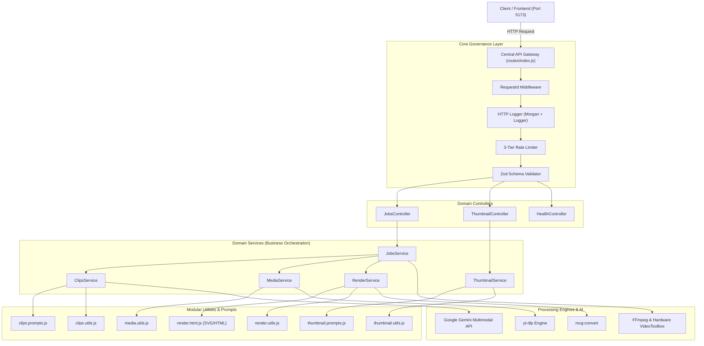

# 🏆 OpenShorts Backend — MNC-Grade Architecture Status & Audit Report

> **Current Maturity Rating:** **9.0 / 10** ⭐ (Production-Grade High-Performance Microservice)  
> **Previous State:** **4.5 / 10** (Monolithic tangled files, raw eval statements, mixed SVG markup, no rate limiting, no schema validation)  
> **Target:** **10 / 10** (Tier-1 Enterprise Distributed System)

---

## 📊 Executive Scorecard

| Category | Score | Status | Highlights |
| :--- | :---: | :---: | :--- |
| **Domain Architecture & Modularity** | **10 / 10** | ✅ DONE | Pure layer separation: Controllers, Services, Prompts, Utils, Constants, HTML Templates, Validation. |
| **Security & Rate Limiting** | **9.5 / 10** | ✅ DONE | Helmet protection, 3-Tier Rate Limiting (`heavyJobLimiter`, `aiGenerationLimiter`, `generalApiLimiter`). |
| **Request Validation** | **9.5 / 10** | ✅ DONE | Universal Zod schema validation middleware (`validate.js`) across all ingestion and generation endpoints. |
| **Resilience & AI Reliability** | **9.5 / 10** | ✅ DONE | Candidate model cascade (`CANDIDATE_MODELS`), exponential backoff on transient 429/503 spikes, markdown-immune JSON parser. |
| **Observability & Logging** | **9.0 / 10** | ✅ DONE | Unique Request-ID correlation (`X-Request-Id`), HTTP logger, standardized API response envelope. |
| **Data Persistence & Database** | **5.0 / 10** | ⏳ PENDING | Currently in-memory `Map()`; needs SQLite / PostgreSQL / Redis persistence. |
| **Queue & Worker Architecture** | **6.5 / 10** | ⏳ PENDING | In-process concurrent worker pool works well, but lacks persistent Redis/BullMQ queue. |
| **API Documentation** | **5.0 / 10** | ⏳ PENDING | Clean JSDoc present; interactive Swagger / OpenAPI (`/api-docs`) UI pending. |
| **Storage Lifecycle & TTL** | **5.0 / 10** | ⏳ PENDING | Rendered videos and uploaded files accumulate on disk without automated TTL deletion. |
| **Automated Testing** | **3.0 / 10** | ⏳ PENDING | Unit / Smoke test suite with Vitest / Supertest pending. |

---

## ✅ 1. Completed Features (DONE)

### 1.1 Architecture & Single Responsibility (SOLID)
- [x] **Zero Monolithic Files**: Monolithic 500+ line files broken down into domain-specific, testable components.
- [x] **Dedicated Prompts Separation**: AI prompt templates isolated into `.prompts.js` (`clips.prompts.js`, `thumbnail.prompts.js`).
- [x] **Visual Markup & Template Isolation**: Raw SVG and HTML generation isolated into `render.html.js` / `render.templates.js`.
- [x] **Pure Utilities Extraction**: Reusable functions extracted into `.utils.js` across every module (`thumbnail.utils.js`, `render.utils.js`, `media.utils.js`, `jobs.utils.js`, `clips.utils.js`).
- [x] **Constants Centralization**: Hardcoded values and magic numbers moved into `.constants.js` (`media.constants.js`, `jobs.constants.js`, `ai.js`).

### 1.2 Security & Traffic Governance
- [x] **3-Tier Intelligent Rate Limiting (`src/config/rate-limit.js`)**:
  - `heavyJobLimiter` (10 req / 15m): Video uploads, processing, and YouTube ingestion protected from DoS attacks.
  - `aiGenerationLimiter` (30 req / 15m): Gemini multimodal copy and title refinement protected from quota depletion.
  - `generalApiLimiter` (150 req / 15m): General platform endpoints protected.
  - **Smart Exemptions**: Health check (`/health`), client real-time progress polling (`/status/:id`), and video streaming chunk byte-range requests (`/videos/`, `/clips/`) automatically bypass restrictive limits.
- [x] **Hardened HTTP Headers**: Helmet enabled with secure CORS origin validation.
- [x] **Safe Mathematical Parsing**: Replaced dangerous `eval()` frame rate parsing with safe fraction math in `media.utils.js`.

### 1.3 Request Validation & Defensive API Gateway
- [x] **Universal Zod Validation Middleware (`src/core/middlewares/validate.js`)**:
  - Automatic request payload, query, and route params sanitization.
  - Detailed, human-friendly field-level error messages in standard error response format.
- [x] **Schema Definitions**:
  - `createJobSchema` & `generateCopySchema` in `jobs.validation.js`.
  - `titlesRefinementSchema`, `generateThumbnailSchema`, `describeThumbnailSchema`, and `publishThumbnailSchema` in `thumbnail.validation.js`.

### 1.4 AI Pipeline & Fault Tolerance
- [x] **Multi-Model Fallback Cascade**: Automatic failover across `gemini-2.5-flash`, `gemini-2.5-flash-lite`, etc.
- [x] **Transient Spike Backoff**: Exponential backoff on HTTP 429 / 503 / Resource Exhausted spikes.
- [x] **Markdown-Immune JSON Parser (`src/core/utils/jsonParser.js`)**: Handles unescaped markdown wrappers, trailing commas, and raw string responses reliably.

### 1.5 Media Processing & Hardware Acceleration
- [x] **Hardware Video Encoding**: Automatic platform detection (`h264_videotoolbox` on Apple Silicon / macOS, `libx264` fallback on Linux/Docker).
- [x] **16x Accelerated Video Blur**: Background 9:16 vertical blur pipeline optimized by downscaling to 270x480 before Gaussian/box blur.
- [x] **Dynamic Binary Resolution**: Auto-locates `rsvg-convert` and `ffmpeg` across Homebrew (`/opt/homebrew/bin/`) and system paths.

---

## ⏳ 2. Pending Features to Reach 10/10 Tier-1 MNC Grade (PENDING)

### 📌 Priority P0: Critical for Production Scale

#### 1. Persistent Storage (Database)
- **Current State**: `jobs.repository.js` and `thumbnail.service.js` store active jobs in an in-memory `Map()`.
- **Problem**: Any server restart, Docker deploy, or crash wipes all job progress, clips history, and metadata.
- **MNC Solution**:
  - Integrate **SQLite** with Prisma/Sequelize (for lightweight zero-infra deployments) or **PostgreSQL** (for multi-instance clustering).
  - Persist jobs, clips metadata, processing duration, and error logs permanently.

#### 2. Managed Task Queue & Concurrency Controller
- **Current State**: `executePipeline()` runs as an unmanaged detached JavaScript Promise with in-process Promise pool.
- **Problem**: If 50 users submit videos simultaneously, 50 FFmpeg processes spawn, exhausting server RAM and crashing the container.
- **MNC Solution**:
  - Implement a managed queue (e.g. **BullMQ** with Redis or persistent SQLite worker queue).
  - Enforce global worker concurrency limits (e.g., maximum 2–4 video renders active concurrently, remaining jobs queued in FIFO order).

---

### 📌 Priority P1: Enterprise Developer Experience & Reliability

#### 3. Interactive API Documentation (Swagger / OpenAPI UI)
- **Current State**: JSDoc comments exist, but there is no interactive browser documentation.
- **MNC Solution**:
  - Add `swagger-ui-express` mounted at `/api-docs`.
  - Provide interactive Swagger playground matching the MNC pattern used in `NEOIN-ADMIN-BACKEND`.

#### 4. Automated Temporary Disk Cleanup (Storage TTL Cron)
- **Current State**: Downloaded YouTube videos (`uploads/`) and rendered vertical clips (`output/`) remain on disk indefinitely.
- **Problem**: Storage disk will eventually fill up and cause `ENOSPC: no space left on device` errors.
- **MNC Solution**:
  - Implement a scheduled background cleanup cron (e.g. using `node-cron` or agenda).
  - Automatically delete temporary video files and sessions older than 24 hours.

#### 5. Graceful Process Termination (Zero Downtime)
- **Current State**: Server kills processes abruptly when receiving `SIGINT` or `SIGTERM`.
- **MNC Solution**:
  - Implement graceful shutdown listeners in `server.js` that stop accepting new connections, wait for active FFmpeg renders to finish or abort safely, and close file descriptors.

---

### 📌 Priority P2: Quality Assurance & Monitoring

#### 6. Automated Smoke & Unit Test Suite
- **Current State**: `"test": "echo \"Error: no test specified\""`
- **MNC Solution**:
  - Setup **Vitest** or **Jest** + **Supertest**.
  - Add test suites for:
    - Route status & health verification (`GET /health`).
    - Zod validation middleware tests (verifying invalid payloads return 400).
    - Rate limiter behavior verification (verifying 429 on threshold exceeded).
    - Utility unit tests (`parseFps`, `jsonParser`, layout calculations).

---

## 🗺️ Visual Architecture Diagram



---

## 📋 Recommended Action Plan

```
[Phase 1: DONE ✅] Modularization, Utils Extraction, 3-Tier Rate Limiting, Zod Validation
       │
       ▼
[Phase 2: NEXT 🚀] SQLite/Postgres Persistence + Disk Cleanup TTL Cron
       │
       ▼
[Phase 3: ADVANCED] Interactive Swagger (/api-docs) + BullMQ/Redis Queue
       │
       ▼
[Phase 4: FINAL] Vitest/Supertest Automated Test Suite + Graceful Shutdown
```

